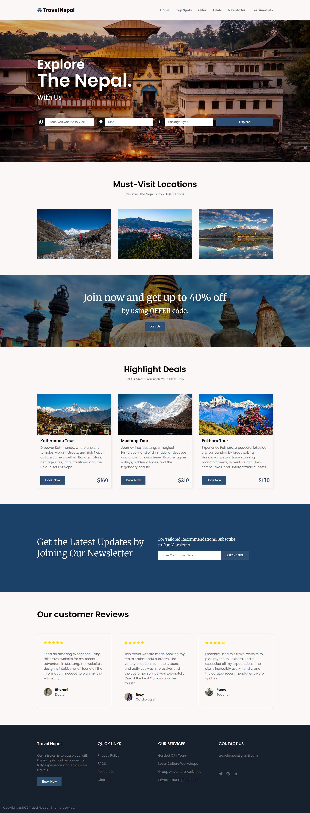
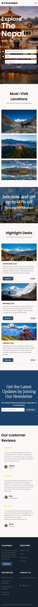

# Travel Nepal

A responsive travel website built with **HTML, CSS, and JavaScript**. The website provides a modern and user-friendly interface for exploring travel packages, viewing offers, reading customer testimonials, subscribing to a newsletter, and accessing travel services.

**Live project:** [Travel Nepal](https://travel-nepal-l3le.onrender.com)

## Technologies Used

- HTML5
- CSS3
- JavaScript
- Remix Icons
- Google Fonts

## Features

- Responsive navigation menu
- Hero section with travel search form
- Travel package and offer sections
- Customer testimonials
- Newsletter subscription form
- Responsive layout for mobile, tablet, and desktop
- Hover effects and smooth scrolling
- Mobile menu toggle using JavaScript

## Project Structure

```text
Travel-Nepal/
├── index.html
├── styles.css
├── main.js
└── assets/
```

## Purpose

This project is created to practice and demonstrate **frontend web development**, including responsive layouts, CSS styling, HTML structure, and basic JavaScript DOM manipulation.

## Future Improvements

- Add backend functionality
- Implement real booking and search features
- Connect newsletter subscription to a database
- Add form validation
- Add payment integration
- Integrate APIs for dynamic travel information

## License

This project is created for **learning and portfolio purposes**.

---

# 1. Desktop View



# 2. Mobile View


